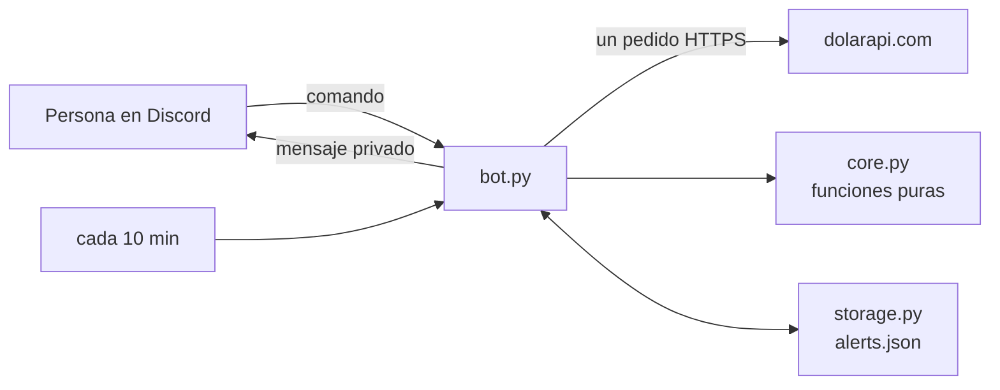

<div align="center">

<picture>
  <source media="(prefers-color-scheme: dark)" srcset="assets/logo-dark.svg">
  
</picture>

# dolar-bot

**El dólar en Argentina, a un comando de distancia, en tu servidor de Discord.**

Cotización oficial, blue, MEP, CCL, cripto y tarjeta; un conversor que usa el precio correcto
según compres o vendas; y avisos privados cuando una cotización llega al número que te importa.

[](https://github.com/bbenedev/dolar-bot/actions/workflows/ci.yml)


[Comandos](#comandos) · [Empezar](#empezar) · [Cómo funciona](#cómo-funciona) · [Pruebas](#pruebas)

[English](README.md) · **Español**

</div>

---

## Por qué

En Argentina no hay un dólar sino varios, y quien cobra, ahorra o paga en dólares los mira
varias veces por día. El blue no aparece en la mayoría de las apps de los bancos. Este bot
lleva los números actuales al lugar donde la comunidad ya conversa, y le avisa a cada persona
en privado cuando una cotización llega al valor que le importa.

## Comandos

| Comando | Qué devuelve |
|---|---|
| `/dolar` | Compra y venta de cada cotización, y la brecha entre el blue y el oficial |
| `/convertir monto moneda tipo` | Dólares a pesos o pesos a dólares, con cualquier cotización |
| `/alerta tipo cuando valor` | Un mensaje privado cuando una cotización sube o baja a un precio |
| `/alertas` | Tus alertas activas, numeradas |
| `/borrar-alerta numero` | Borra una de ellas |

`/dolar` responde con una tabla como esta (salida real, con las cotizaciones del 20/10/2026):

```text
Tipo                            Compra         Venta
Oficial                     $ 1.495,00    $ 1.545,00
Blue                        $ 1.550,00    $ 1.570,00
Bolsa                       $ 1.542,50    $ 1.548,80
Contado con liquidación     $ 1.628,90    $ 1.630,90
Mayorista                   $ 1.516,00    $ 1.525,00
Cripto                      $ 1.624,27    $ 1.626,08
Tarjeta                     $ 1.943,50    $ 2.008,50

Brecha blue / oficial: 1.6%
```

Y `/convertir monto:100 moneda:dólares tipo:blue`:

```text
USD 100.00 vendidos al Blue ($ 1.550,00) = $ 155.000,00
```

## Empezar

1. Creá una aplicación y un bot en el
   [portal de desarrolladores de Discord](https://discord.com/developers/applications) e
   invitalo a tu servidor con el permiso `applications.commands`.
2. Corrélo:

```bash
git clone https://github.com/bbenedev/dolar-bot
cd dolar-bot
pip install .
export DISCORD_TOKEN="tu token"      # PowerShell: $env:DISCORD_TOKEN="tu token"
python -m dolar_bot.bot
```

| Variable | Obligatoria | Valor por defecto | Para qué |
|---|---|---|---|
| `DISCORD_TOKEN` | sí | — | El token del bot. Se lee solo del entorno, nunca de un archivo del repo |
| `DOLAR_BOT_DATA` | no | `~/.dolar-bot/alerts.json` | Dónde se guardan las alertas |

El bot **no le pide a Discord permisos especiales**: no lee mensajes ni listas de miembros.

## Cómo funciona



| Archivo | Responsabilidad |
|---|---|
| `core.py` | Leer la respuesta de la API, formato de números argentino, conversión, brecha, regla de alertas. Sin red y sin Discord |
| `storage.py` | Alertas en un archivo JSON, escrito en un archivo temporal y renombrado, para que un corte no deje medio archivo |
| `bot.py` | La capa fina que conecta todo con Discord y con la API |

<details>
<summary><b>Detalles fáciles de hacer mal, y que tienen pruebas</b></summary>

- **Vender dólares usa el precio de *compra*; comprarlos usa el de *venta*.** Es lo que una
  persona realmente recibe o paga.
- Una alerta **exactamente** en el valor elegido se dispara.
- Una cotización que falta en la API **nunca** dispara una alerta.
- Un dato roto en la respuesta de la API no descarta los buenos.
- Un archivo de alertas dañado significa "sin alertas", nunca un cierre del bot.
- Cada persona puede tener hasta 5 alertas; la misma alerta dos veces se guarda una sola.
- Si el mensaje privado falla (privados cerrados), la alerta se conserva y se reintenta en la
  vuelta siguiente.
- La API rechaza el identificador por defecto de Python (error 403), así que el bot se
  identifica con su nombre.
- Cuando la API no responde, el bot lo dice en vez de mostrar números viejos.

</details>

## Pruebas

```bash
pip install -e ".[dev]"
pytest
```

22 pruebas cubren la lógica y el guardado de alertas. La CI las corre, junto con el revisor de
código y el de formato, en Python 3.10, 3.12 y 3.13. Los comandos de Discord son una capa
fina y no se probaron contra un servidor real en este repositorio.

## De dónde salen los datos

Las cotizaciones vienen de la API pública y gratuita [dolarapi.com](https://dolarapi.com). El
bot hace un pedido por comando y uno cada 10 minutos para las alertas. Los números son
informativos y no son un consejo financiero.

## Licencia

[MIT](LICENSE)
