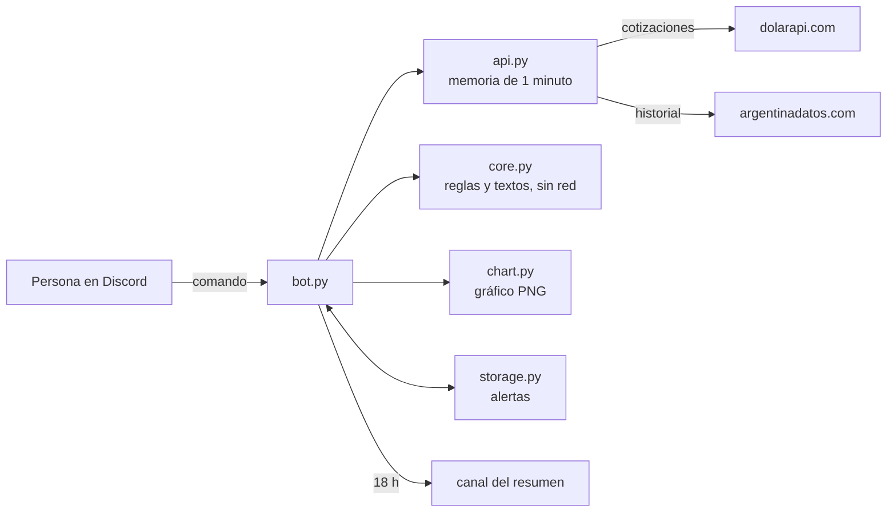

<div align="center">

<picture>
  <source media="(prefers-color-scheme: dark)" srcset="assets/logo-dark.svg">
  
</picture>

# DOLAR CHE

**El dólar, como lo preguntamos en Argentina, adentro de tu servidor de Discord.**

Blue, oficial, MEP, CCL, cripto y tarjeta, con la hora exacta de cada cotización. Conversor,
compras con tarjeta, otras monedas, gráficos del historial, alertas por privado y un resumen
cada tarde.

[](https://github.com/bbenedev/dolar-che/actions/workflows/ci.yml)


[Comandos](#comandos) · [Probalo sin Discord](#probalo-sin-discord) · [Ponerlo en tu servidor](#ponerlo-en-tu-servidor) · [Cómo funciona](#cómo-funciona)

[English](README.md) · **Español**

</div>

---

## Comandos

| Comando | Qué hace |
|---|---|
| `/dolar` | Todas las cotizaciones, la brecha y **a qué hora se tomó cada una** |
| `/convertir` | Dólares a pesos o pesos a dólares, con el dólar que elijas |
| `/compra` | Cuánto te sale en pesos algo en dólares con tarjeta, impuestos incluidos |
| `/monedas` | Euro, real, peso chileno y peso uruguayo |
| `/historial` | Gráfico de los últimos 7, 30, 90 o 365 días |
| `/alerta` | Te aviso por privado cuando un dólar sube o baja al valor que digas |
| `/alertas`, `/borrar-alerta` | Ver y borrar tus alertas (hasta 5) |
| `/ayuda` | Todo lo anterior, en corto |
| *Resumen diario* | Todos los días a las 18 h, en el canal que elijas: cómo cerró y cuánto se movió |

## Así responde

Salidas reales del modo de prueba (cotizaciones del 20/10/2026):

```text
💵 Así está el dólar, che:
                Compra       Venta
Oficial      $1.495,00   $1.545,00
Blue         $1.550,00   $1.570,00
MEP          $1.542,50   $1.548,80
CCL          $1.628,90   $1.630,90
Mayorista    $1.516,00   $1.525,00
Cripto       $1.624,27   $1.626,08
Tarjeta      $1.943,50   $2.008,50
Brecha blue / oficial: 1,6 %
🕒 Cotizado entre ayer a las 12:39 y ayer a las 17:56 (hora argentina)
```

```text
💳 Algo de US$ 20,00 con tarjeta te sale unos $40.170,00.
Dólar tarjeta: $2.008,50, con los impuestos incluidos. Es una referencia: tu banco puede cobrar un poco distinto.
```

```text
🧉 Así cerró el dólar hoy, 21/10:
▲ Blue: $1.570,00 (+$10,00, +0,6 % contra el 20/10)
▲ Oficial: $1.545,00 (+$5,00, +0,3 % contra el 20/10)
▲ MEP: $1.548,80 (+$4,70, +0,3 % contra el 20/10)
▲ CCL: $1.630,90 (+$5,30, +0,3 % contra el 20/10)
```

`/historial tipo:Blue dias:30`:

<p align="center"></p>

```text
📈 Dólar Blue, últimos 30 días (precio de venta)
22/09: $1.550,00 → 21/10: $1.570,00 ▲ +$20,00 (+1,3 %)
Mínimo $1.540,00 el 09/10 · Máximo $1.570,00 el 21/10
```

## Probalo sin Discord

El modo de prueba muestra en la consola exactamente lo que respondería el bot, con datos
reales, y guarda el gráfico como imagen. No necesita token ni servidor.

```bash
git clone https://github.com/bbenedev/dolar-che
cd dolar-che
pip install .
dolar-che-preview            # todos los comandos
dolar-che-preview historial  # uno solo: dolar, monedas, convertir, compra, historial, resumen
```

## Ponerlo en tu servidor

1. Creá una aplicación y un bot en el
   [portal de desarrolladores de Discord](https://discord.com/developers/applications) e
   invitalo a tu servidor con los permisos `applications.commands` y "Enviar mensajes".
2. Arrancalo:

```bash
export DISCORD_TOKEN="tu token"                 # PowerShell: $env:DISCORD_TOKEN="tu token"
export DOLAR_CHE_CANAL_RESUMEN="id del canal"   # opcional, para el resumen diario
dolar-che
```

| Variable | Obligatoria | Para qué |
|---|---|---|
| `DISCORD_TOKEN` | sí | El token del bot. Solo se lee del entorno, nunca de un archivo del repo |
| `DOLAR_CHE_CANAL_RESUMEN` | no | El canal donde sale el resumen de las 18 h. Sin esto, no hay resumen |
| `DOLAR_CHE_DATA` | no | Dónde se guardan las alertas (por defecto `~/.dolar-che/alerts.json`) |

El bot no le pide a Discord permisos especiales: no lee mensajes ni la lista de miembros.

## Cómo funciona



- **Toda la lógica es pura** (`core.py`): formatos argentinos, conversión, hora de la
  cotización, historial, resumen y alertas. Se prueba sin red y sin Discord.
- **Una consulta sirve para muchos:** las respuestas se guardan un minuto, así que si veinte
  personas piden `/dolar` a la vez, se hace un solo pedido.
- **Nunca muestra un dato viejo como nuevo:** cada cotización dice a qué hora se tomó, y el
  resumen diario no se publica los fines de semana ni cuando todavía no hay cierre del día.
- **Las alertas no se pierden:** se guardan en un archivo temporal que después se renombra, así
  un corte no deja el archivo por la mitad; si un mensaje privado falla, se reintenta.

<details>
<summary><b>Detalles fáciles de hacer mal, y que tienen pruebas</b></summary>

- Vender dólares usa el precio de **compra**; comprarlos usa el de **venta**.
- La hora se pasa de UTC a hora argentina: las 02:30 UTC del 22 son las 23:30 del 21.
- El dólar tarjeta de la fuente ya incluye los impuestos, así que no se suman a mano.
- Monedas chicas, como el peso chileno, se muestran con cuatro decimales.
- Un dato roto en la respuesta no descarta los buenos.

</details>

## Pruebas

```bash
pip install -e ".[dev]"
pytest
```

44 pruebas sobre la lógica, el gráfico, la memoria de un minuto y el guardado de alertas. La CI
las corre en Python 3.10, 3.12 y 3.13. Los comandos de Discord son una capa fina y no se
probaron contra un servidor real en este repositorio.

## De dónde salen los datos

Cotizaciones de [dolarapi.com](https://dolarapi.com) e historial de
[argentinadatos.com](https://argentinadatos.com), las dos gratuitas. El historial a veces
repite el último valor para el día en curso antes del cierre; por eso el resumen se publica a
las 18 h. Los números son informativos y no son un consejo financiero.

## Licencia

[MIT](LICENSE)
