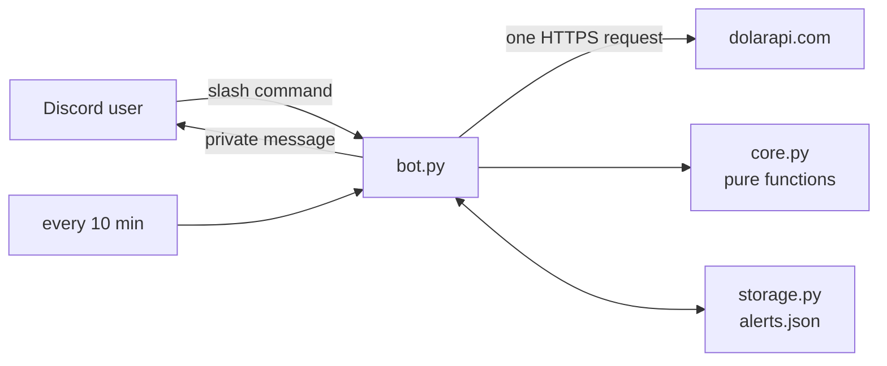

<div align="center">

<picture>
  <source media="(prefers-color-scheme: dark)" srcset="assets/logo-dark.svg">
  
</picture>

# dolar-bot

**The Argentine dollar, one slash command away, in your Discord server.**

Official, blue, MEP, CCL, crypto and card rates, a converter that uses the right side of the
spread, and private alerts when a rate reaches your number.

[](https://github.com/bbenedev/dolar-bot/actions/workflows/ci.yml)


[Commands](#commands) · [Quick start](#quick-start) · [How it works](#how-it-works) · [Tests](#tests)

**English** · [Español](README.es.md)

</div>

---

## Why

In Argentina there is not one dollar but several, and people who earn, save or pay in
dollars check them many times a day, and the "blue" rate is not in most bank apps. This bot
brings the current numbers to the place where a community already talks, and warns each
person privately when a rate reaches the value they care about.

## Commands

| Command | What you get |
|---|---|
| `/dolar` | Buy and sell price of every rate, and the gap between blue and official |
| `/convertir monto moneda tipo` | Dollars to pesos or pesos to dollars, at any rate |
| `/alerta tipo cuando valor` | A private message when a rate goes up to, or down to, a price |
| `/alertas` | Your active alerts, numbered |
| `/borrar-alerta numero` | Delete one of them |

`/dolar` replies with a table like this one (real output, with the rates of 20/10/2026):

```text
Tipo                            Compra         Venta
Oficial                     $ 1.495,00    $ 1.545,00
Blue                        $ 1.550,00    $ 1.570,00
Bolsa                       $ 1.542,50    $ 1.548,80
Contado con liquidación     $ 1.628,90    $ 1.630,90
Mayorista                   $ 1.516,00    $ 1.525,00
Cripto                      $ 1.624,27    $ 1.626,08
Tarjeta                     $ 1.943,50    $ 2.008,50

Brecha blue / oficial: 1.6%
```

And `/convertir monto:100 moneda:dólares tipo:blue`:

```text
USD 100.00 vendidos al Blue ($ 1.550,00) = $ 155.000,00
```

## Quick start

1. Create an application and a bot at the
   [Discord developer portal](https://discord.com/developers/applications) and invite it to
   your server with the `applications.commands` scope.
2. Run it:

```bash
git clone https://github.com/bbenedev/dolar-bot
cd dolar-bot
pip install .
export DISCORD_TOKEN="your token"      # PowerShell: $env:DISCORD_TOKEN="your token"
python -m dolar_bot.bot
```

| Variable | Required | Default | Purpose |
|---|---|---|---|
| `DISCORD_TOKEN` | yes | — | The bot token. Read only from the environment, never from a file in the repo |
| `DOLAR_BOT_DATA` | no | `~/.dolar-bot/alerts.json` | Where alerts are stored |

The bot asks Discord for **no privileged intents**: it does not read messages or member lists.

## How it works



| File | Responsibility |
|---|---|
| `core.py` | Read the API answer, Argentine number format, conversion, gap, alert rule. No network, no Discord |
| `storage.py` | Alerts in a JSON file, written to a temporary file and renamed, so a crash cannot leave half a file |
| `bot.py` | The thin layer that connects them to Discord and to the API |

<details>
<summary><b>Details that are easy to get wrong, and are tested</b></summary>

- **Selling dollars uses the *buy* price; buying uses the *sell* price.** That is what a
  person actually gets or pays.
- An alert at **exactly** the target fires.
- A rate missing from the API **never** fires an alert.
- One broken entry in the API answer does not discard the good ones.
- A corrupt alerts file means "no alerts", never a crash.
- Each person can have up to 5 alerts; the same alert twice is stored once.
- An alert is kept if the private message fails (closed DMs), and tried again next round.
- The API refuses Python's default `User-Agent` (HTTP 403), so the bot identifies itself.
- When the API is down the bot says so instead of showing old numbers.

</details>

## Tests

```bash
pip install -e ".[dev]"
pytest
```

22 tests cover the logic and the storage. CI runs them, the linter and the formatter check on
Python 3.10, 3.12 and 3.13. The Discord commands themselves are a thin layer and were not
tested against a live server in this repository.

## Data source

Rates come from the free public API at [dolarapi.com](https://dolarapi.com). The bot makes one
request per command and one every 10 minutes for alerts. The numbers are for information and
are not financial advice.

## License

[MIT](LICENSE)
