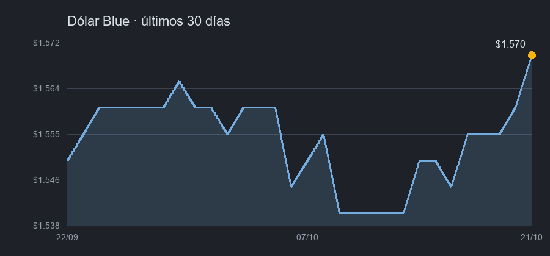
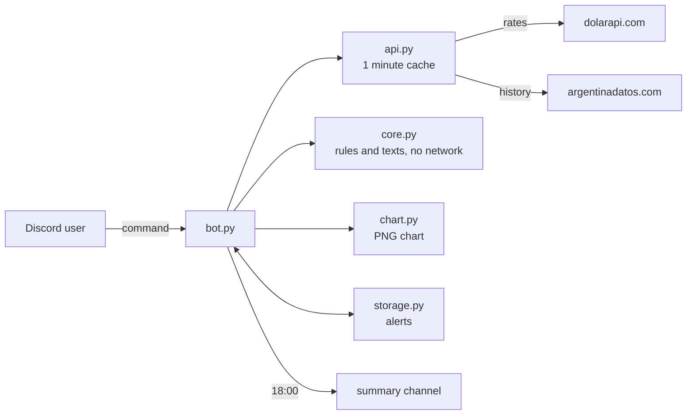

<div align="center">

<picture>
  <source media="(prefers-color-scheme: dark)" srcset="assets/logo-dark.svg">
  
</picture>

# DOLAR CHE

**The Argentine dollar, the way Argentines ask about it, inside your Discord server.**

Blue, official, MEP, CCL, crypto and card rates, each with the exact time it was quoted.
A converter, card purchases, other currencies, history charts, private alerts and a summary
every afternoon. The bot speaks Argentine Spanish.

[](https://github.com/bbenedev/dolar-che/actions/workflows/ci.yml)


[Commands](#commands) · [Try it without Discord](#try-it-without-discord) · [Add it to your server](#add-it-to-your-server) · [How it works](#how-it-works)

**English** · [Español](README.es.md)

</div>

---

## Commands

| Command | What it does |
|---|---|
| `/dolar` | Every rate, the blue/official gap, and **when each one was quoted** (Argentine time) |
| `/convertir` | Dollars to pesos or pesos to dollars, at the rate you choose |
| `/compra` | What a purchase in dollars costs in pesos with a card, taxes included |
| `/monedas` | Euro, Brazilian real, Chilean and Uruguayan peso |
| `/historial` | A chart of the last 7, 30, 90 or 365 days, with buttons to switch period and rate |
| `/resumen` | How each dollar moved today, this week or this month |
| `/alerta` | A private message when a rate goes up or down to your number |
| `/alertas`, `/borrar-alerta` | List and delete your alerts (up to 5) |
| `/ayuda` | All of the above, briefly |
| `/resumen-aca`, `/resumen-apagar` | Choose the channel for the daily summary, or turn it off (admins) |
| *Daily summary* | Every day at 18:00 in a channel you choose: how each rate closed and how much it moved |

Replies are Discord cards with buttons: refresh, open the chart, create an alert with a
short form, or switch the chart's period without typing again. Every option of every
command has a description and a list to pick from, and every reply suggests what to try next.

## What it answers

Real output from the preview mode (rates of 20/10/2026):

```text
💵 Así está el dólar, che:
                Compra       Venta
Oficial      $1.495,00   $1.545,00
Blue         $1.550,00   $1.570,00
MEP          $1.542,50   $1.548,80
CCL          $1.628,90   $1.630,90
Mayorista    $1.516,00   $1.525,00
Cripto       $1.624,27   $1.626,08
Tarjeta      $1.943,50   $2.008,50
Brecha blue / oficial: 1,6 %
🕒 Cotizado entre ayer a las 12:39 y ayer a las 17:56 (hora argentina)
```

```text
🧉 Así cerró el dólar hoy, 21/10:
▲ Blue: $1.570,00 (+$10,00, +0,6 % contra el 20/10)
▲ Oficial: $1.545,00 (+$5,00, +0,3 % contra el 20/10)
▲ MEP: $1.548,80 (+$4,70, +0,3 % contra el 20/10)
▲ CCL: $1.630,90 (+$5,30, +0,3 % contra el 20/10)
```

`/historial tipo:Blue dias:30`:

<p align="center"></p>

## Try it without Discord

The preview mode prints exactly what the bot would answer, with real data, and saves the
chart as an image. No token and no server needed.

```bash
git clone https://github.com/bbenedev/dolar-che
cd dolar-che
pip install .
dolar-che-preview            # every command
dolar-che-preview historial  # just one: dolar, monedas, convertir, compra, historial, resumen
```

## Add it to your server

1. Create an application and a bot at the
   [Discord developer portal](https://discord.com/developers/applications) and invite it with
   the `applications.commands` scope and "Send Messages".
2. Save the bot token in `~/.dolar-che/token` (one line, outside the repository), or set
   `DISCORD_TOKEN`.
3. Start it with `dolar-che`.
4. In the channel where you want the 18:00 summary, run `/resumen-aca` (server admins only).
   `/resumen-apagar` turns it off.

| Setting | Purpose |
|---|---|
| `~/.dolar-che/token` or `DISCORD_TOKEN` | The bot token. Never stored in the repository |
| `/resumen-aca` or `DOLAR_CHE_CANAL_RESUMEN` | The channel for the daily summary. Without it there is no summary |
| `DOLAR_CHE_HOME` | Another folder instead of `~/.dolar-che` (token, alerts, settings) |
| `DOLAR_CHE_DATA` | Another file for the alerts |

The bot's profile picture is in [`assets/avatar.png`](assets/avatar.png), ready to upload in
the developer portal.

The bot asks Discord for no privileged intents: it does not read messages or member lists.

## Run it on a home server (Docker, CasaOS)

It uses about 60 MB of memory and almost no CPU, so any always-on machine will do.

```bash
git clone https://github.com/bbenedev/dolar-che && cd dolar-che
mkdir data && nano data/token      # paste the bot token, one line, save
sudo chown 1000 data               # the container runs as an unprivileged user
docker compose up -d --build
docker logs -f dolar-che           # should say "DOLAR CHE ready as ..."
```

It restarts on its own after a reboot (`restart: unless-stopped`), keeps alerts and settings
in `./data`, and is capped at 256 MB and half a CPU. In CasaOS the container shows up in the
dashboard like any other app.

## How it works



- **All the logic is pure** (`core.py`): Argentine number formats, conversion, quote time,
  history, summary and alerts. It is tested without network or Discord.
- **One request serves many people:** answers are cached for a minute, so twenty people asking
  `/dolar` at once cost one request.
- **Old data is never shown as new:** every rate says when it was quoted, and the daily summary
  is skipped on weekends and whenever there is no close for the day yet.
- **Alerts are not lost:** they are written to a temporary file and renamed, so a crash cannot
  leave half a file; a failed private message is retried.

<details>
<summary><b>Details that are easy to get wrong, and are tested</b></summary>

- Selling dollars uses the **buy** price; buying them uses the **sell** price.
- Times are converted from UTC to Argentine time: 02:30 UTC on the 22nd is 23:30 on the 21st.
- The source's card rate already includes taxes, so nothing is added by hand.
- Small currencies, such as the Chilean peso, are shown with four decimals.
- One broken entry in an answer does not discard the good ones.

</details>

## Tests

```bash
pip install -e ".[dev]"
pytest
```

60 tests cover the logic, the chart, the one-minute cache and alert storage. CI runs them on
Python 3.10, 3.12 and 3.13. The Discord commands themselves are a thin layer and were not
tested against a live server in this repository.

## Data sources

Rates from [dolarapi.com](https://dolarapi.com) and history from
[argentinadatos.com](https://argentinadatos.com), both free. The history sometimes repeats the
latest value for the current day before the close, which is why the summary goes out at 18:00.
The numbers are for information and are not financial advice.

## License

[MIT](LICENSE)
